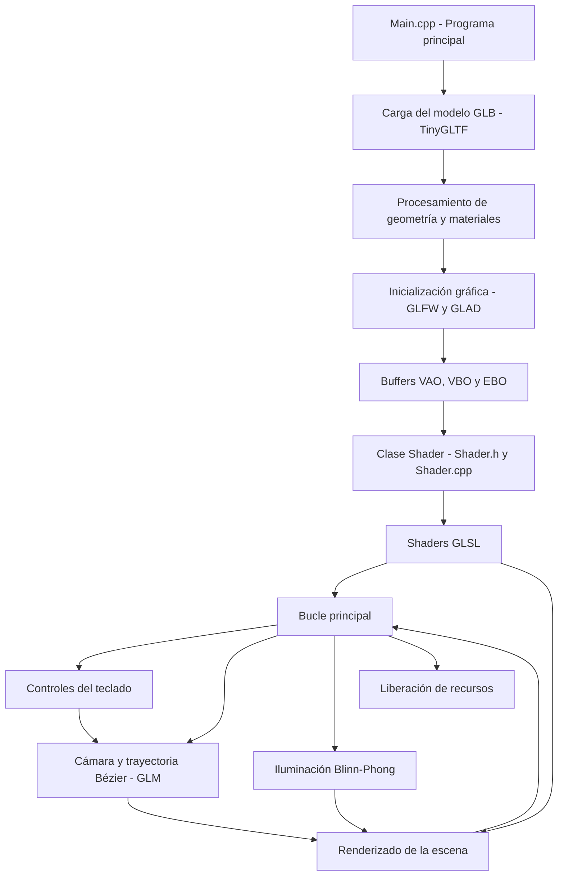

# SciFi Girl | Exhibición 3D Interactiva

**Estudiante:** Nicoll Xiomara Jimenez Reyes 
**Código estudiantil:** 6014411  
**Universidad:** Universidad Militar Nueva Granada- Campus  
**Programa:** Ingeniería en Multimedia  
**Asignatura:** Computación Gráfica  
**Proyecto:** Visualización y animación de un modelo 3D con OpenGL  
**Año:** 2026

---

## Descripción del proyecto

Este proyecto consiste en la visualización de un personaje tridimensional llamado **SciFi Girl**, desarrollado en C++ mediante OpenGL 3.3.

Su propósito es aplicar conceptos de gráficos por computadora, como la carga de modelos 3D, las transformaciones geométricas, la iluminación, el manejo de cámaras y las trayectorias mediante curvas de Bézier.

La aplicación permite interactuar con el personaje dentro de una escena tridimensional, utilizando diferentes opciones de cámara, iluminación y movimiento.

## 1. Características del proyecto

- Visualización de un personaje 3D con sus materiales y texturas.
- Iluminación Blinn-Phong para mejorar la apariencia del modelo.
- Rotación automática del personaje.
- Cámara manual controlada mediante el teclado.
- Cámara automática con trayectoria de Bézier.
- Luz móvil que cambia de posición alrededor de la escena.
- Visualización de la trayectoria de la cámara.
- Opciones para pausar y activar o desactivar diferentes efectos.
- Implementación de una clase `Shader` para administrar los programas gráficos.

## 2. Herramientas y tecnologías

| Tecnología | Función |
|---|---|
| C++ | Lenguaje utilizado para desarrollar la aplicación. |
| OpenGL 3.3 | Renderizado de los elementos tridimensionales. |
| GLFW | Creación de la ventana y lectura de entradas del teclado. |
| GLAD | Acceso a las funciones de OpenGL. |
| GLM | Operaciones matemáticas y transformaciones 3D. |
| TinyGLTF | Lectura del modelo en formato GLB. |
| stb_image | Procesamiento de imágenes y texturas. |
| GLSL | Programación de los shaders utilizados en la escena. |
| Visual Studio | Entorno de desarrollo y compilación. |

## 3. Arquitectura y funcionamiento del programa

El proyecto utiliza una arquitectura modular sencilla, donde `Main.cpp` coordina la carga del modelo, la configuración de OpenGL, las cámaras, las animaciones, la iluminación y el renderizado.

Además, se implementó una clase `Shader`, separada en los archivos `Shader.h` y `Shader.cpp`, para administrar los programas de shaders utilizados por OpenGL.

Esta organización permite distribuir las responsabilidades del código y facilita su comprensión y mantenimiento.

### 3.1. Diagrama de arquitectura

### 3.2. Flujo de ejecución

El funcionamiento general del programa se desarrolla mediante las siguientes etapas:

1. **Carga del modelo:** se lee el archivo GLB y se extraen sus vértices, índices, normales, materiales y texturas.
2. **Construcción de la escena:** se organizan las mallas y se calculan las transformaciones necesarias.
3. **Inicialización gráfica:** se crea la ventana y se configuran GLFW, GLAD y OpenGL.
4. **Configuración de shaders:** se preparan los programas utilizados para representar el modelo y la trayectoria.
5. **Preparación de buffers:** se transfieren los datos geométricos a la GPU mediante VAO, VBO y EBO.
6. **Actualización:** se procesan las entradas del teclado y se calculan los movimientos del personaje, la cámara y la luz.
7. **Renderizado:** se dibuja el modelo utilizando sus materiales, texturas e iluminación.
8. **Finalización:** se liberan los recursos gráficos y se cierra la aplicación.

### 3.3. Lectura y construcción del modelo

El archivo principal utilizado por la aplicación es:

`models/scifi_girl_v.01.glb`

La biblioteca TinyGLTF permite obtener la información del modelo, incluyendo sus mallas, vértices, índices, materiales y texturas.

Para organizar estos datos se utilizan tres estructuras:

- `Vertice`: almacena posición, normal, coordenadas de textura y color.
- `Parte`: identifica un conjunto de índices y su material.
- `Escena`: reúne los vértices, índices y partes del modelo.

Entre las funciones principales se encuentran:

| Función | Descripción |
|---|---|
| `datosAccessor()` | Localiza los datos almacenados en los buffers del GLB. |
| `leerIndice()` | Interpreta los índices utilizados para formar los triángulos. |
| `matrizNodo()` | Obtiene las transformaciones de cada nodo del modelo. |
| `agregarMalla()` | Extrae la geometría y la incorpora a la escena. |
| `visitarNodo()` | Recorre la jerarquía de nodos del archivo GLB. |
| `construirEscena()` | Organiza la geometría para enviarla a OpenGL. |

El programa también calcula normales cuando una malla no las proporciona, lo que permite realizar los cálculos de iluminación.

### 3.4. Preparación de la geometría

Una vez obtenidos los datos del modelo, se transfieren a la GPU mediante los siguientes elementos:

**VAO (Vertex Array Object):** almacena la configuración de los atributos de los vértices.

**VBO (Vertex Buffer Object):** guarda la información de los vértices, como sus posiciones, normales y coordenadas de textura.

**EBO (Element Buffer Object):** contiene los índices utilizados para formar los triángulos.

El dibujo de las diferentes partes del personaje se realiza mediante:

`glDrawElements(GL_TRIANGLES, ...)`

Esto permite representar las mallas del personaje utilizando los materiales correspondientes.

### 3.5. Shaders y renderizado

El proyecto utiliza shaders escritos en GLSL para procesar la geometría y calcular el color de los fragmentos.

**Vertex Shader**

Se encarga de transformar los vértices utilizando las matrices:

- `model`: posición, escala y rotación del personaje.
- `view`: posición y orientación de la cámara.
- `projection`: perspectiva de la escena.

La transformación general se expresa como:

`gl_Position = projection * view * model * vec4(aPos, 1.0);`

**Fragment Shader**

Calcula el color visible de cada fragmento, combinando:

- Textura del modelo.
- Color del material.
- Color del vértice.
- Iluminación de la escena.

También se utilizan shaders adicionales para dibujar la trayectoria de la cámara.

### 3.6. Iluminación Blinn-Phong

La escena incorpora iluminación con componentes ambientales, difusas y especulares.

- **Ambiental:** mantiene una iluminación básica sobre el personaje.
- **Difusa:** depende de la orientación de la superficie respecto a la luz.
- **Especular:** produce reflejos que ayudan a destacar la forma del modelo.

El cálculo se realiza dentro del Fragment Shader, utilizando un vector intermedio entre la dirección de la luz y la dirección de observación para calcular la componente especular.

La aplicación permite activar o desactivar esta iluminación para comparar la apariencia del personaje.

También se implementa una luz móvil cuya posición cambia con el tiempo mediante funciones trigonométricas.

### 3.7. Cámara y trayectoria de Bézier

El proyecto cuenta con dos formas de controlar la cámara.

**Cámara manual**

Permite desplazarse por el entorno y modificar la dirección de observación utilizando el teclado.

La orientación se calcula mediante los ángulos `yaw` y `pitch`, mientras que la matriz de vista se construye con `glm::lookAt()`.

**Cámara automática**

Utiliza curvas de Bézier cúbicas para generar una trayectoria cerrada alrededor del personaje.

La ecuación empleada es:

`B(t) = (1-t)^3 P0 + 3(1-t)^2 t P1 + 3(1-t)t^2 P2 + t^3 P3`

Donde `P0`, `P1`, `P2` y `P3` representan los puntos de control y `t` determina la posición sobre la curva.

Las funciones utilizadas son:

- `bezier()`: calcula un punto de una curva cúbica.
- `trayectoria()`: conecta cuatro tramos de Bézier para formar un recorrido cerrado.

La cámara se desplaza por esta trayectoria mientras mantiene su orientación hacia el personaje.

### 3.8. Interacción y actualización de la escena

El programa utiliza un bucle principal que permanece activo mientras la ventana esté abierta.

Durante cada iteración se realizan las siguientes operaciones:

1. Lectura de eventos y entradas del teclado.
2. Actualización del tiempo de animación.
3. Cálculo de la posición de la cámara.
4. Actualización de la rotación del personaje.
5. Cálculo de la posición de la luz.
6. Configuración de matrices y shaders.
7. Dibujo del modelo y, opcionalmente, de la trayectoria.
8. Actualización de la ventana.

La función `teclaNueva()` permite detectar pulsaciones individuales para cambiar los modos sin repetir continuamente la acción mientras una tecla permanece presionada.

## 4. Implementación de la clase Shader

Para mejorar la organización del proyecto, se implementó una clase `Shader` que permite administrar los programas de shaders utilizados en OpenGL.

Anteriormente, la compilación y el enlazado de los shaders se realizaban directamente en `Main.cpp`. Con esta modificación, estas tareas se separaron del código principal, facilitando su comprensión, mantenimiento y reutilización.

### 4.1. Organización de los archivos

- **Shader.h:** contiene la declaración de la clase `Shader` y sus métodos.
- **Shader.cpp:** implementa las funciones necesarias para compilar, enlazar y utilizar los programas de shaders.
- **Main.cpp:** coordina la carga del modelo, las transformaciones, la cámara, la iluminación y el renderizado.

### 4.2. Funcionamiento de la clase

La clase `Shader` administra los programas utilizados por la GPU para procesar los vértices y determinar la apariencia de los fragmentos.

Sus responsabilidades principales son:

1. Compilar el Vertex Shader y el Fragment Shader.
2. Enlazar ambos shaders en un programa de OpenGL.
3. Comprobar posibles errores de compilación o enlazado.
4. Activar el programa correspondiente durante el renderizado.
5. Configurar variables `uniform`, como matrices de transformación, colores y parámetros de iluminación.

### 4.3. Aplicación en SciFi Girl
